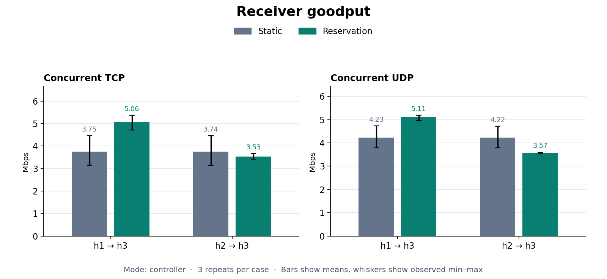
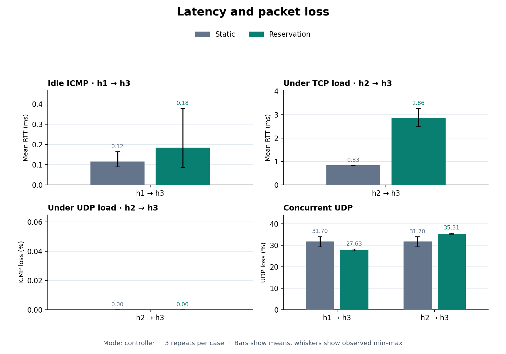

# Project 15 – Network Resource Reservation System

TCP-based service where clients request bandwidth. The reservation server admits
or rejects each request against the link capacity, and the Ryu SDN controller
turns every accepted reservation into an OpenFlow policy (meter + flow) on the
Open vSwitch in a Mininet network. Expired or released reservations have their
policy removed.

```
  h1 (C1) 10.0.0.1 ─┐                                 ┌──────────────────────────┐
  h2 (C2) 10.0.0.2 ─┼── s1 (OVS, OpenFlow 1.3) ───────│ Ryu controller           │
  h3 (C3) 10.0.0.3 ─┤        ▲  OpenFlow :6653         │  controller/controller.py│
  h4      10.0.0.4 ─┘        └─────────────────────────│  HTTP API :8081          │
   │ TCP reservation server (server/server.py :5000)   └────────────▲─────────────┘
   └────────── HTTP/JSON  POST /api/reservation (reserve / release) ┘
```

| Step | What happens |
|---|---|
| 1 | Client on h1/h2/h3 sends `{"type":"RESERVE","client_id":"C1","bandwidth":4,"duration":30}` over TCP to h4:5000 |
| 2 | Server checks capacity under a lock and marks the reservation PENDING |
| 3 | Server calls the controller: `POST /api/reservation {"action":"reserve", ...,"client_ip":"10.0.0.1"}` |
| 4 | Controller installs an OpenFlow meter (rate = reserved Mbps) + flow `ip,nw_src=10.0.0.1 → meter, NORMAL` |
| 5 | Server replies ACCEPTED (or REJECTED, and rolls back if the controller failed) |
| 6 | On expiry/release the server sends `{"action":"release"}` and the flow + meter are deleted |

**h4 runs in the VM's root network namespace** so the server can reach both the
clients (through s1) and the controller API on `127.0.0.1:8081`. A normal Mininet
host could not reach the controller API. *(This supersedes the "server on h3"
suggestion in `mininet/INTEGRATION.md`.)*

## Team

| Member | SRN | Module |
|---|---|---|
| Ankitha P (integrator) | PES1UG25AM043 | TCP server, client, reservation manager, integration and testing |
| Aryan V Jain | PES1UG25AM058 | Ryu SDN controller, OpenFlow meters, controller API |
| Arjun Sharma | PES1UG25AM051 | Mininet topology, QoS benchmark, performance graphs |

## Folder layout

| Folder | Owner | Contents |
|---|---|---|
| `server/` | Ankitha P | `server.py` (TCP server, threads, controller calls), `reservation_manager.py` (capacity, lock, expiry, utilisation) |
| `client/` | Ankitha P | `client.py` (interactive or one-shot) |
| `tests/` | Ankitha P | `test_server_controller.py` – TC01–TC10 against the controller API |
| `controller/` | Aryan V Jain | `controller.py` (Ryu app), `api_handler.py`, `policy_store.py`, `mock_controller.py`, `config/config.json`, unit + Mininet tests. Details: [controller/README.md](controller/README.md) |
| `mininet/` | Arjun Sharma | `topology.py` (h1–h4, s1), `test_cases.py` + `qos.py` (static vs reservation benchmark), `plot_results.py`, `config/network.json`. Details: [mininet/README.md](mininet/README.md) |
| `results/` | all | test result CSVs and logs |

Aryan V Jain's `reservation_manager.py` was renamed to `controller/policy_store.py` so it
does not clash with the server's `reservation_manager.py`.

## Setup (Ubuntu 20.04 VM – needed for Ryu 4.34 / Python 3.8)

```bash
sudo apt update
sudo apt install -y python3-venv python3-pip mininet openvswitch-switch iperf3 iproute2 ethtool python3-matplotlib
sudo systemctl enable --now openvswitch-switch

cd Network-Resource-Reservation/controller
python3 -m venv venv && source venv/bin/activate
pip install -r ../requirements.txt
ryu-manager --version          # expect 4.34
```

Capacity must match in both places: `--capacity` of the server and
`total_bandwidth_mbps` in `controller/config/config.json` (both default to 10).

## Running the full system (4 terminals in the VM)

**Terminal 1 – SDN controller**
```bash
cd Network-Resource-Reservation/controller && source venv/bin/activate
ryu-manager controller.py
```

**Terminal 2 – Mininet topology**
```bash
cd Network-Resource-Reservation/mininet
sudo python3 topology.py
```
```text
mininet> nodes
mininet> net
mininet> pingall
```

**Terminal 3 – reservation server** (after the topology is up, since it binds 10.0.0.4)
```bash
cd Network-Resource-Reservation
python3 server/server.py --host 10.0.0.4 --port 5000 --capacity 10
```

**Clients – from the Mininet prompt** (host shells start in `mininet/`)
```text
mininet> h1 python3 ../client/client.py --server 10.0.0.4 reserve C1 4 60
mininet> h2 python3 ../client/client.py --server 10.0.0.4 reserve C2 3 30
mininet> h3 python3 ../client/client.py --server 10.0.0.4 reserve C3 5 60
mininet> h1 python3 ../client/client.py --server 10.0.0.4 list
mininet> sh ovs-ofctl -O OpenFlow13 dump-flows s1
mininet> sh ovs-ofctl -O OpenFlow13 dump-meters s1
```
Interactive client: `mininet> xterm h1`, then `python3 ../client/client.py --server 10.0.0.4`.

**Check the policy is enforced** (iPerf3 server on h3, client h1 limited to 4 Mbps):
```text
mininet> h3 iperf3 -s -D
mininet> h1 iperf3 -c 10.0.0.3 -t 10
mininet> h2 iperf3 -c 10.0.0.3 -t 10
```
After C2's 30 s expire, the server prints `Reservation R002 expired. 3 Mbps released.`,
`dump-flows` no longer shows the flow for 10.0.0.2, and h2's iPerf3 is unrestricted again.

### Client protocol (newline-delimited JSON over TCP, port 5000)

| Request | Reply |
|---|---|
| `{"type":"RESERVE","client_id":"C1","bandwidth":4,"duration":60}` | `{"status":"ACCEPTED","reservation_id":"R001","allocated_bandwidth":4,"remaining_bandwidth":6,...}` or `{"status":"REJECTED","reason":"..."}` |
| `{"type":"RELEASE","client_id":"C1","reservation_id":"R001"}` | `{"status":"OK","released_bandwidth":4,...}` |
| `{"type":"STATUS"}` / `{"type":"LIST"}` | utilisation, counters, all reservations, rejection log |

Plain text `RESERVE C1 4 60` also works (e.g. with `nc 10.0.0.4 5000`).

## Tests

| Command | Where | What |
|---|---|---|
| `python3 tests/test_server_controller.py` | any OS | TC01–TC10 with server + Aryan V Jain's mock controller |
| `python3 tests/test_server_controller.py --use-running-controller http://127.0.0.1:8081` | VM, Ryu running | same against the real controller |
| `cd controller && python3 -m unittest discover -s tests` | any OS | 23 controller/API unit tests |
| `cd mininet && python3 -m unittest discover -s tests` | any OS | 15 offline topology/benchmark tests |
| `sudo python3 controller/mininet_tests/e2e_test.py` | VM, Ryu running, no other topology | real flows/meters + iPerf enforcement |
| `cd mininet && bash scripts/run_benchmark.sh` | VM, Ryu running, no other topology | static vs reservation performance comparison |

## Results

All runs on Ubuntu 26.04 (VirtualBox), Mininet 2.3.0, Open vSwitch 3.7.1, Ryu 4.34
(Python 3.9 venv), iPerf 3.20, 15 Nov 2026. Screenshots are in `results/screenshots/`.

### Live end-to-end demo (real Ryu controller + Mininet)

| Test | Input | Expected | Actual (live) | Evidence |
|---|---|---|---|---|
| TC01 | h1: C1 4 Mbps, 300 s | Accepted | ACCEPTED R001, 6 Mbps left | `05_demo_…png` |
| TC02 | h2: C2 3 Mbps, 120 s | Accepted | ACCEPTED R002, 3 Mbps left | `05_demo_…png` |
| TC03 | h3: C3 5 Mbps | Rejected | REJECTED – "only 3 Mbps available" | `05_demo_…png` |
| TC04 | C9 −3 Mbps | Rejected | REJECTED – "bandwidth must be greater than 0" | `08_…TC04…png` |
| TC05 | wait for C2's 120 s | Resources released | "R002 expired. 3 Mbps released. Available bandwidth: 6 Mbps" | `06_server_log…png` |
| TC07 | accepted reservations | SDN policy installed | `nw_src=10.0.0.1 → meter:1` (rate 4000 kbps), `nw_src=10.0.0.2 → meter:2` (rate 3000 kbps) | `05_demo_…png` |
| TC08 | after C2 expired | SDN policy removed | 10.0.0.2 flow gone from `dump-flows`; server log "SDN policy REMOVED for R002" | `05_demo_…png`, `06_…png` |
| TC09 | every client disconnects | Server continues | server keeps serving all later clients | `06_server_log…png` |
| TC06, TC10 | concurrency / controller failure | – | covered by the automated test below | `person1_test_results.csv` |

Decision log of all live requests: `results/reservation_log_vm.csv`.

Full logs of a live demo run (15 Nov 2026, 14:56–15:01), captured with `tee` / `script`:

| Log | What it shows |
|---|---|
| [`results/logs/controller.log`](results/logs/controller.log) | Ryu start-up, switch connect, `Installed meter 1 + flows for R001`, `Installed meter 2 … R002`, `Removed meter 2 + flows for R002` on expiry |
| [`results/logs/server.log`](results/logs/server.log) | Every client connection, ACCEPTED R001 / R002, REJECTED C3, `SDN policy REMOVED for R002`, `R002 expired. 3 Mbps released` |
| [`results/logs/mininet_demo.log`](results/logs/mininet_demo.log) | The Mininet session: client replies, `dump-flows` and `dump-meters` before and after the expiry |

### Policy enforcement (iPerf3, reservation active for h1 only)

| Flow | Reservation | Result |
|---|---|---|
| h1 → h3 TCP | 4 Mbps | 1.78 Mbps received (431 retransmissions – the meter drops excess, TCP backs off) |
| h2 → h3 TCP | none | 32.9 Gbps (unrestricted) |
| h1 → h3 UDP, 10 Mbps offered | 4 Mbps | **3.92 Mbps received, 61 % loss** – the meter caps h1 at its reservation |

`results/integrated_performance_results.csv`, screenshots `07_…`, `09_…`.

### Static vs reservation comparison (Arjun Sharma's benchmark, 3 repeats, 10 Mbps bottleneck, h1 reserved 6 Mbps via HTB)



| Scenario | Static h1 | Reservation h1 | Static h2 | Reservation h2 |
|---|---|---|---|---|
| Concurrent TCP (Mbps) | 3.75 | **5.06** (+35 %) | 3.74 | 3.53 |
| Concurrent UDP (Mbps) | 4.23 | **5.11** (+21 %) | 4.22 | 3.57 |
| UDP loss (%) | 31.7 | **27.6** | 31.7 | 35.3 |
| RTT h2→h3 under TCP load (ms) | – | – | 0.83 | 2.86 |

With the static policy both flows split the link equally. With the reservation the
reserved flow (h1) gets a larger, more stable share, at the cost of the unreserved
flow (h2), whose latency also rises because its class is the one that queues.
h1 stays below the configured 6 Mbps because of TCP/UDP header overhead and the
two classes borrowing from each other; this is measured goodput, not a guarantee.
### Latency and packet loss, static vs reservation



| Measurement | Static | Reservation |
|---|---|---|
| Idle RTT h1→h3 (ms) | 0.12 | 0.18 |
| RTT h2→h3 under TCP load (ms) | 0.83 | 2.86 |
| UDP loss h1, reserved (%) | 31.7 | 27.6 |
| UDP loss h2, unreserved (%) | 31.7 | 35.3 |

Idle latency is the same under both policies. Under load, the reservation protects
the reserved flow (h1 loses fewer packets) and the unreserved flow pays for it: h2's
round-trip time rises from 0.83 to 2.86 ms and its loss from 31.7 % to 35.3 %.

Raw data: `mininet/results/run-20261115T083403812863146Z/`, `results/performance_results.csv`.

### Automated test (Windows, mock controller – 14 Nov 2026)

| Test | Input | Expected | Actual |
|---|---|---|---|
| TC01 | Request 4 Mbps | Accepted | ACCEPTED, 6 Mbps left |
| TC02 | Another 3 Mbps | Accepted | ACCEPTED, 3 Mbps left |
| TC03 | Another 5 Mbps | Rejected | REJECTED – only 3 Mbps available |
| TC04 | Negative / non-numeric bandwidth, bad JSON, duplicate client | Rejected | REJECTED / ERROR |
| TC05 | 3 s reservation | Resources released | EXPIRED, bandwidth back |
| TC06 | 8 simultaneous 2 Mbps requests with 6 Mbps free | No over-allocation | 3 accepted, 10/10 Mbps |
| TC07 | Accepted reservation | SDN policy installed | controller holds R001, R002 |
| TC08 | Expired/released | SDN policy removed | removed from controller |
| TC09 | Client disconnects mid-request | Server continues | server alive, answers |
| TC10 | Controller down | Rollback, no false success | REJECTED, capacity unchanged |

Full output: `results/person1_test_results.csv`, `results/test_server_log.txt`.

## Verification status

- [x] Ryu controller starts; switch connects (`Switch connected: dpid=0000000000000001`)
- [x] `pingall` 0 % loss with h1–h4 (12/12)
- [x] Live demo: accept / accept / reject, flows + meters installed, expiry removes the flow
- [x] iPerf3: meter caps h1 at its reservation (UDP 10 → 3.92 Mbps)
- [x] `run_benchmark.sh`: all live checks PASS, real CSV + graphs
- [ ] `controller/mininet_tests/e2e_test.py` (Aryan V Jain's own automated Mininet test) – not run

Note: start the benchmark only after all reservations have expired or the controller
was restarted. The controller re-installs active reservations when a switch connects,
so a leftover meter on h1 would distort the comparison (this happened in a first
attempt, which was discarded).

Note: `sudo mn -c` also kills `ryu-manager`. Run it before starting the controller.

## Known limitations

- OpenFlow meters **cap** a client at its reserved rate (policing); they do not guarantee a minimum under congestion. Arjun Sharma's `qos.py` benchmark shows the HTB alternative. Don't run the HTB benchmark and the meter demo at the same time on the same traffic.
- One active reservation per client ID (and per client IP on the controller).
- State is in memory. Restarting the server releases leftover reservations on the controller at startup.
- h4 has address 10.0.0.4 in the VM's root namespace. If the VM's own LAN also uses 10.0.0.0/24, change the subnet in `mininet/config/network.json`.
- The controller API has no authentication and listens on localhost only.
