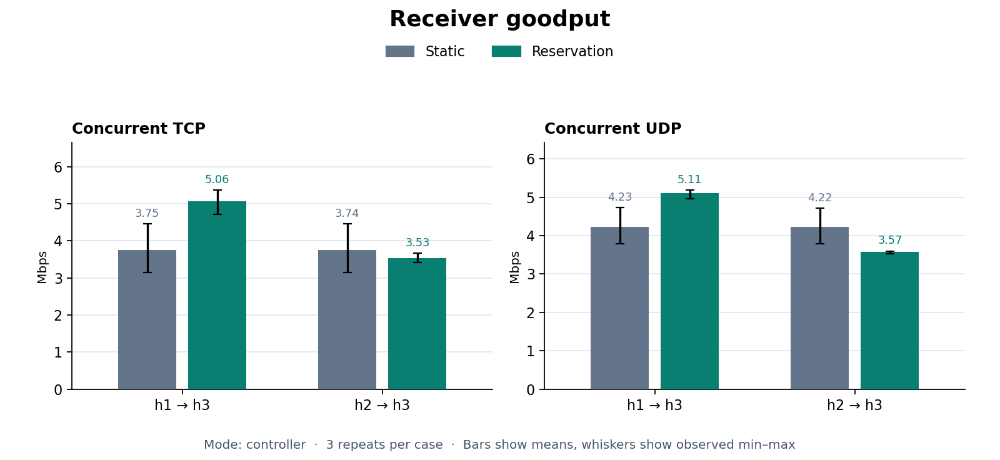
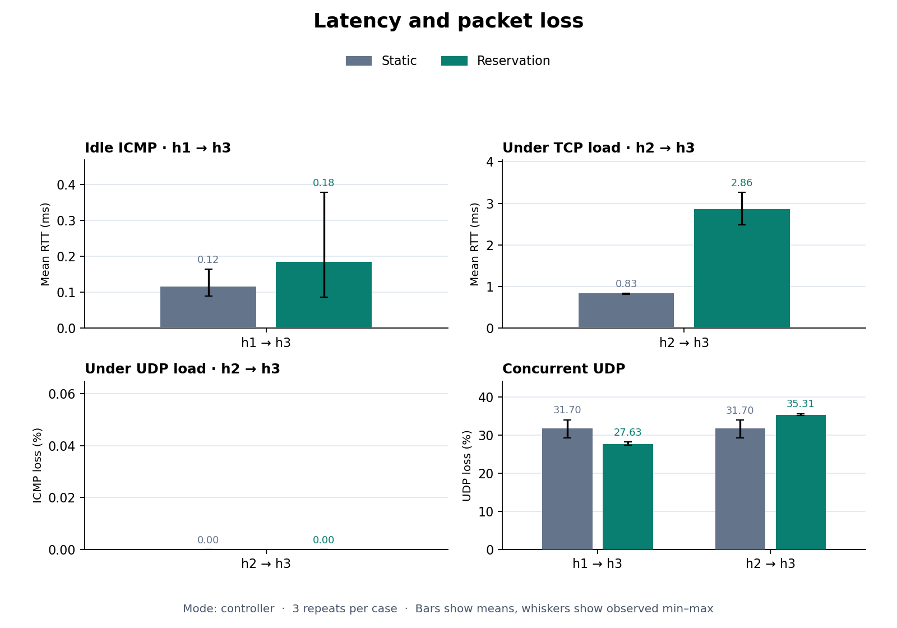

# Results analysis

All numbers below were measured on the team's Ubuntu VM on 15 Nov 2026 (Mininet 2.3.0,
Open vSwitch 3.7.1, Ryu 4.34, iPerf 3.20). Benchmark values are means of 3 runs, with the
lowest and highest run in brackets.

## 1. Admission control is correct

The server admitted requests exactly up to the 10 Mbps capacity and never beyond it.

| Request | Free before | Decision | Free after |
|---|---|---|---|
| C1, 4 Mbps | 10 Mbps | ACCEPTED (R001) | 6 Mbps |
| C2, 3 Mbps | 6 Mbps | ACCEPTED (R002) | 3 Mbps |
| C3, 5 Mbps | 3 Mbps | REJECTED, insufficient bandwidth | 3 Mbps |
| C2 expires after 120 s | 3 Mbps | 3 Mbps released | 6 Mbps |
| C9, −3 Mbps | 6 Mbps | REJECTED, invalid request | 6 Mbps |

Under concurrency, 8 simultaneous 2 Mbps requests with 6 Mbps free gave exactly 3 accepted
and 10 / 10 Mbps used: the lock around the capacity check and the PENDING record prevents
over-allocation. With the controller stopped, a request was rejected and rolled back with
capacity unchanged, so the server never reports a reservation the network does not enforce.

Sources: [`logs/server.log`](logs/server.log), [`reservation_log_vm.csv`](reservation_log_vm.csv), [`person1_test_results.csv`](person1_test_results.csv).

## 2. The SDN policy is enforced in the data plane

With C1's 4 Mbps reservation active, the OpenFlow meter on s1 limits h1, while h2 (no
reservation) is untouched.

| Flow | Reservation | Sent | Received | Observation |
|---|---|---|---|---|
| h1 → h3, UDP | 4 Mbps | 10.0 Mbps | 3.92 Mbps | 98 % of the reservation; 61 % of packets dropped by the meter |
| h1 → h3, TCP | 4 Mbps | 1.99 Mbps | 1.78 Mbps | 431 retransmissions |
| h2 → h3, TCP | none | 32.9 Gbps | 32.9 Gbps | unrestricted baseline |

UDP shows the meter's cap precisely. TCP reaches well under the cap because a meter is a
policer: it drops packets above the rate, and TCP reacts to each drop by halving its sending
window. A shaper (a queue) would delay those packets instead, and TCP would get closer to the
reserved rate. This is the main difference between the meter used in the live system and the
HTB queues used in the benchmark below.

Sources: [`integrated_performance_results.csv`](integrated_performance_results.csv), screenshots `07` and `09`, [`logs/controller.log`](logs/controller.log).

## 3. Static vs reservation policy

Two flows, h1 → h3 and h2 → h3, compete for a 10 Mbps bottleneck. Static: one shared
class. Reservation: h1 gets a 6 Mbps HTB class, the rest gets 4 Mbps, both may borrow.

| Flow | Static | Reservation | Change |
|---|---|---|---|
| h1 TCP (reserved) | 3.75 (3.15–4.45) | **5.06** (4.72–5.37) | **+35 %** |
| h1 UDP (reserved) | 4.23 (3.79–4.73) | **5.11** (4.96–5.19) | **+21 %** |
| h2 TCP (unreserved) | 3.74 (3.15–4.45) | 3.53 (3.41–3.66) | −6 % |
| h2 UDP (unreserved) | 4.22 (3.79–4.73) | 3.57 (3.53–3.60) | −15 % |
| Both TCP flows together | 7.49 | 8.60 | +15 % |

Values in Mbps of receiver goodput.

- **The reservation works as intended.** Under the static policy the two flows split the link
  almost exactly in half. With the reservation, h1 gets the larger share.
- **It is also more predictable.** h1's TCP results spread over 1.31 Mbps across runs
  without a reservation, and over only 0.66 Mbps with one.
- **The gain comes from the unreserved flow.** h2 loses 6 % (TCP) to 15 % (UDP).
- **h1 stays below its 6 Mbps class rate**, because the rate counts headers that goodput does
  not, and because the default class borrows unused capacity.
- A single TCP flow alone reached 7.25 Mbps (static) and 6.81 Mbps (reservation), so neither
  policy wastes the link when there is no competition.

## 4. Latency and packet loss

| Measurement | Static | Reservation |
|---|---|---|
| Idle RTT h1 → h3 | 0.12 ms | 0.18 ms |
| RTT h2 → h3 during TCP load | 0.83 ms | **2.86 ms** |
| RTT h2 → h3 during UDP load | 2.00 ms | 1.82 ms |
| UDP loss, h1 (reserved) | 31.7 % | **27.6 %** |
| UDP loss, h2 (unreserved) | 31.7 % | 35.3 % |

Idle latency is the same under both policies. Under TCP load the unreserved flow waits
longer, because its class is the one that queues. The reserved flow loses fewer packets and
the unreserved flow more. No ICMP probe was lost in any case.

Sources: [`performance_results.csv`](performance_results.csv), [`../mininet/results/run-20261115T083403812863146Z/`](../mininet/results/run-20261115T083403812863146Z/).

## 5. Conclusions

1. Admission control never over-allocated, including under simultaneous requests and with
   the controller unavailable.
2. Every accepted reservation became an OpenFlow meter and flow on the switch within the
   request, and was removed on expiry.
3. The meter caps a reserved client at its rate (UDP 3.92 of 4 Mbps); it limits, but does
   not guarantee, bandwidth.
4. A queue-based reservation gives the reserved flow 21–35 % more goodput and steadier
   results under congestion, paid for by the unreserved flow in throughput and latency.
5. Next step: combine the two, installing an OVS queue with a minimum rate for each accepted
   reservation, so the controller's policy becomes a guarantee rather than a cap.
